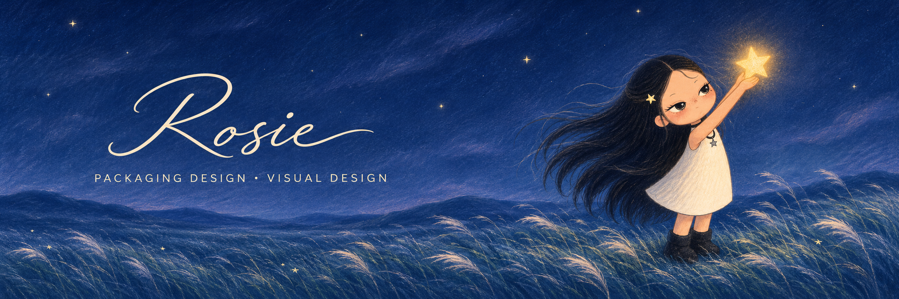

# Rosie · 设计师

我做品牌视觉、产品 3D 渲染和包装设计。一件产品用什么图形让人记住，镜头里怎样呈现它的材质，包装印出来是什么样子，都是我关心的问题。我也在尝试做一些自己愿意每天用的小工具，解决设计里反复遇到的小麻烦。

## 正在做 · 图稿重构

**让手机拍下的图稿，还能接着改。**

拍下一张包装草图后，我希望能直接改掉盒面上的一行字，把旁边的图标往上挪一点。为此，我正在做一个原型，尝试识别照片里的文字和图形，把它们还原成可以单独调整的元素，省下手动重绘的时间。

## 设计方向

- **品牌视觉** · 标志、图标与品牌物料
- **产品表现** · 3D 渲染、产品展示与广告分镜
- **包装设计** · 版式、材质与印刷工艺
